<div align="center">
  
  <h1>UltraUnityVerse</h1>
  <p><strong>A multi-agent AI career platform: your career, unified.</strong></p>
  <p>
    
    
    
    
    
  </p>
</div>

UltraUnityVerse keeps your whole career in one record, then turns it into portfolio websites and resumes. A team of AI agents helps you add details, change designs, customize resumes in plain English, and compare a resume with a job description.

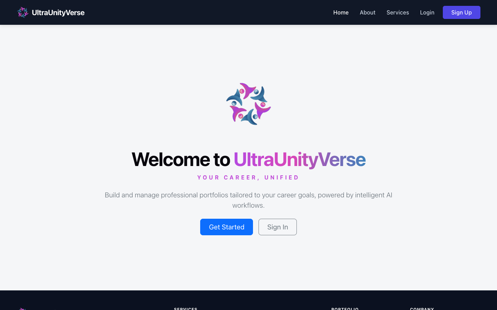

> Every screenshot uses a fictional demo profile, "Alex Morgan". All names, companies, and contact details are made up.

## Contents

- [Features](#features)
- [Screenshots](#screenshots)
- [What you can ask the resume chat](#what-you-can-ask-the-resume-chat)
- [How it works](#how-it-works)
- [Tech stack](#tech-stack)
- [Run it locally](#run-it-locally)
- [Optional settings](#optional-settings)
- [Useful commands](#useful-commands)
- [Host it online](#host-it-online)
- [Project structure](#project-structure)
- [Security and privacy](#security-and-privacy)
- [Project status](#project-status)
- [Author](#author)
- [License](#license)

## Features

### Portfolio builder

Record your career once, then reuse it everywhere:

- Profile, professional summary, skills, and certifications
- Work experience and education, with their own projects, tasks, and attachments
- Personal projects, achievements, volunteering, publications, patents, and interests
- Recommendations from people you've worked with
- Separate switches for showing an entry in your portfolio or on your resumes

### 45 portfolio designs

View your portfolio in 45 designs, each in light and dark mode, grouped into Minimal, Creative, Classic, Playful, Developer, and Professional. You can also create a custom version in chat, for example: "Make a dark green Slate called Forest and hide projects".

### 28 resume designs

Choose from one-column and two-column designs, change the colour, choose what each resume shows, and save it as a PDF.

### CV Maker

Build a plain, ATS-focused resume from your portfolio and tailor it to a job description.

### JobPilot resume match

Upload a resume as a PDF, DOCX, RTF, or TXT file and paste a job description. JobPilot then:

- Scores the match requirement by requirement
- Shows the evidence behind each score
- Tells apart skills that are only listed from skills shown in real work
- Runs a separate ATS check
- Suggests rewrites of your own bullets that name what the job asks for where your work already shows it, with the match and keyword scores before and after. It never adds a skill the resume doesn't support
- Saves each result to a Log Book for 72 hours

### Portfolio assistant

A chat assistant is available throughout the dashboard:

| Agent | Example |
|---|---|
| **Data entry** | "I did my MS in CS at UNT, 2021 to 2023" |
| **Design** | "Use Playfair Display for headings" |
| **Q&A** | "Which projects used LangGraph?" |

The data entry agent asks for any required details that are missing, then holds the entry for you to confirm. The Q&A agent answers from your own portfolio and lists its sources. When a request could mean more than one entry, the agents ask which one. Every change the agents make can be undone from the chat, one message at a time.

### Accounts and administration

Session-based login, password reset, activity logs, light and dark themes, and an admin console for users, sessions, databases, storage, system status, and audit logs.

## Screenshots

### Dashboard

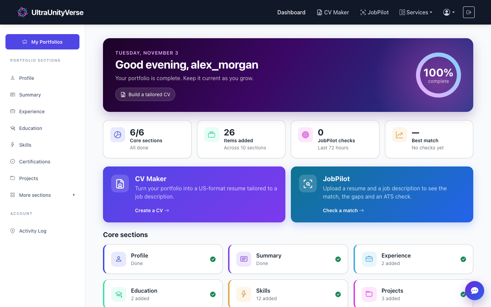

### Assistant answering from your portfolio

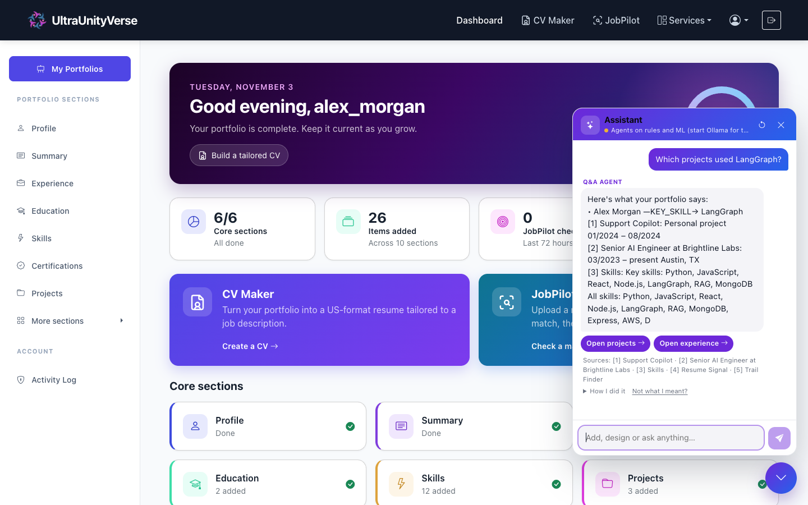

### Portfolio designs

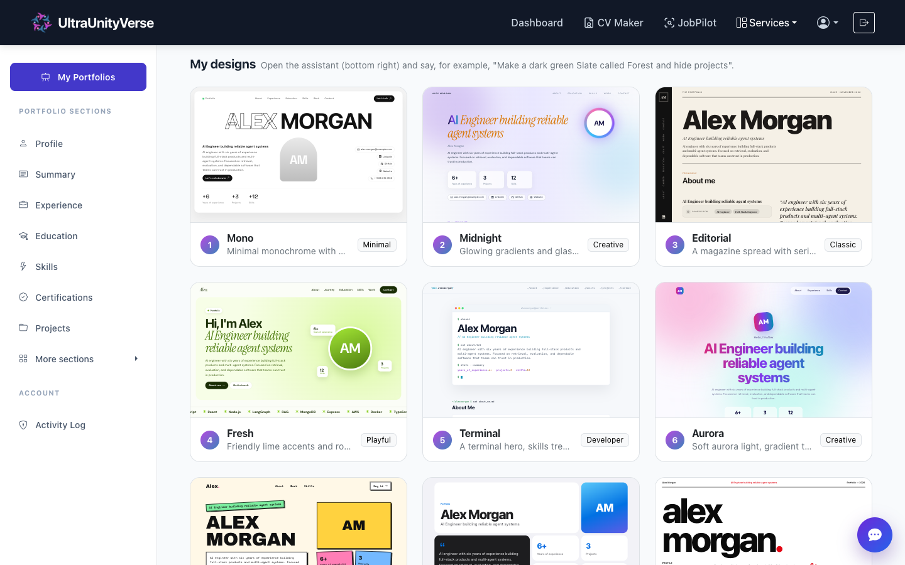

<table>
  <tr>
    <td width="50%">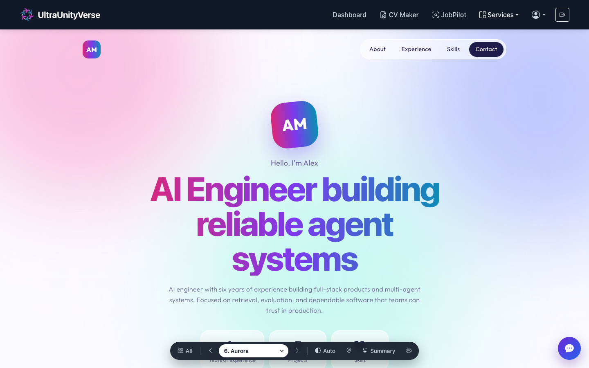</td>
    <td width="50%">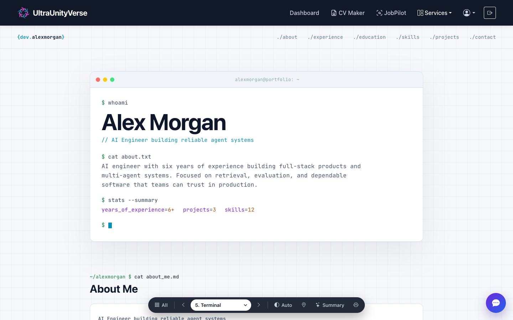</td>
  </tr>
  <tr>
    <td align="center"><strong>Aurora</strong></td>
    <td align="center"><strong>Terminal</strong></td>
  </tr>
</table>

### Resume designs

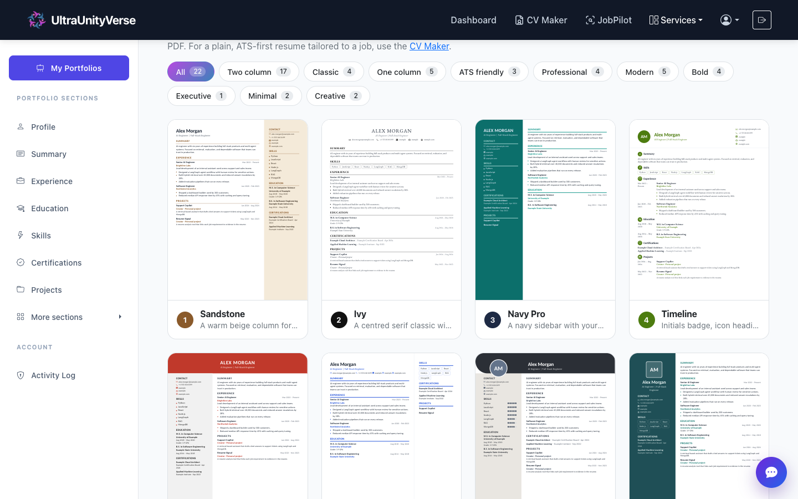

### Customizing a resume in chat

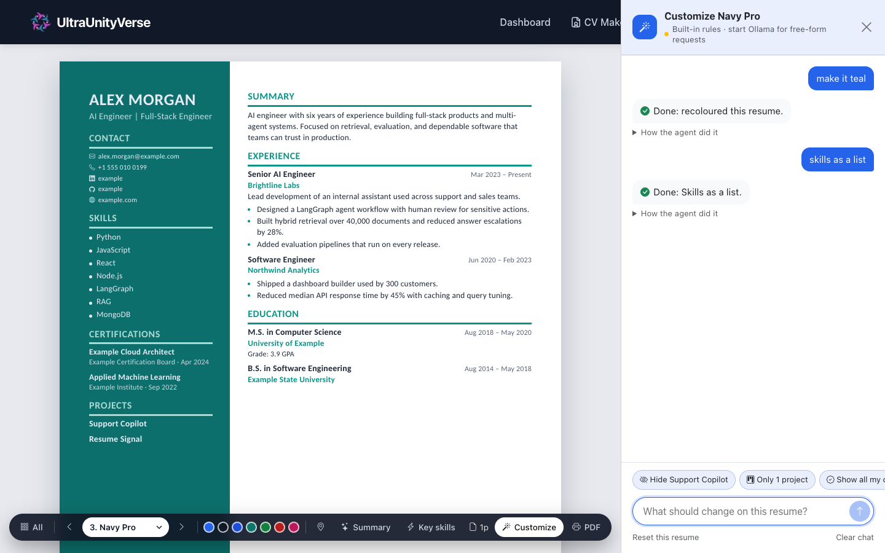

### JobPilot resume match

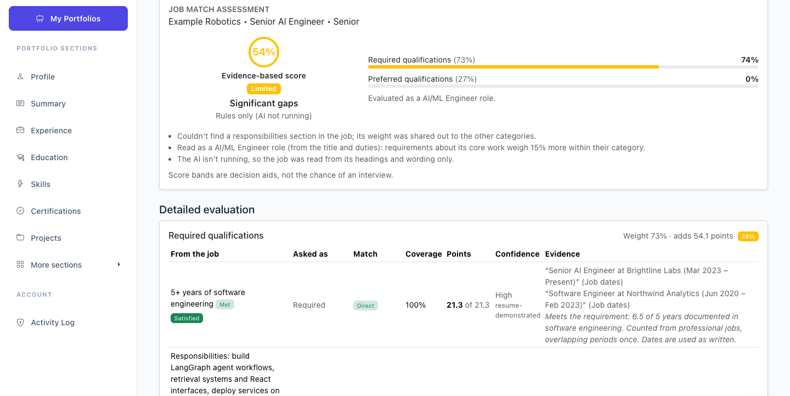

### Custom error pages

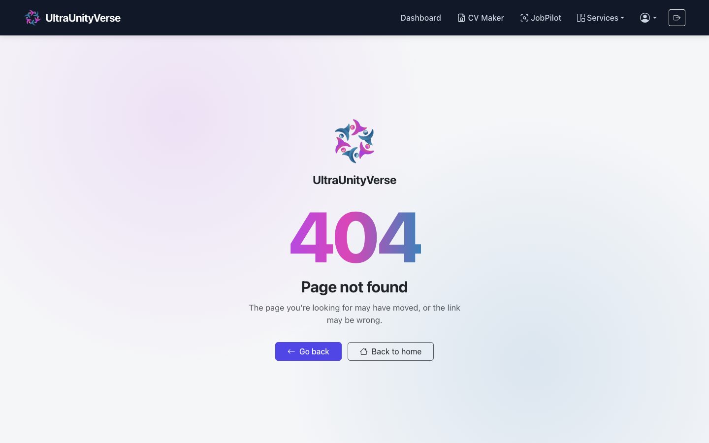

## What you can ask the resume chat

Each designed resume has its own chat. Changes apply to that resume unless you say otherwise.

| What you want | Try saying |
|---|---|
| Hide or restore an entry | "hide the Blood Bank project", "put back the Blood Bank project" |
| Remove one detail from an entry | "remove the grade in MS", "remove the location from Acme", "remove the dates from Blood Bank" |
| Remove contact details | "remove my phone number", "remove my LinkedIn", "remove my contact details" |
| Remove page sections | "hide the summary", "remove my headline" |
| Control how much is shown | "only 2 jobs", "only 1 project", "show all my certifications", "all skills" |
| Add or remove sections | "add interests", "remove publications", "hide volunteering" |
| Move sections | "move Education to the right column", "put Projects before Experience", "move Skills to the top", "swap Education and Experience" |
| Change how skills look | "skills in boxes", "skills as a list", "skills as bars", "skills as dots", "skills on one line" |
| Change the colour | "make it navy", "default colour" |
| Change wording on the resume only | "change my summary to ...", "rename Projects to Things I built", "change AWS to Amazon Web Services" |
| Undo wording changes | "restore the original wording" |
| Apply a change more widely | "hide Docker from every resume", "hide Blood Bank from my portfolio" |
| Ask questions | "what's on this resume?", "what did I hide?", "which projects use LangGraph?" |
| Start over | "reset this resume" |

If the language model is running, you can also ask for new wording with requests like "rewrite my summary".

The chat explains what it can't do, such as changing fonts, adding a photo, forcing a page count, translating a resume, or sending it for you.

## How it works

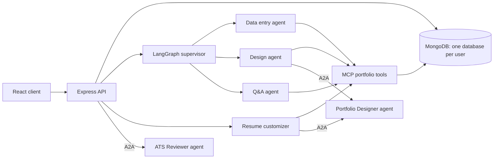

- **Routing:** the supervisor sends each chat message to the right agent using wording rules, trained intent models, and, when those aren't sure, a language model. If it's still unsure, it asks the user.
- **Agent actions:** agents read and change portfolio data through Model Context Protocol (MCP) tools.
- **Separate agents:** the ATS Reviewer and Portfolio Designer run on their own ports and communicate over the Agent2Agent (A2A) protocol.
- **Answers from your data:** hybrid RAG and GraphRAG search the user's own portfolio.
- **Fallbacks:** when Ollama isn't running, rule-based and trained-model features keep working. Search falls back to keywords, and designs are planned in-process if the A2A agent is unavailable.
- **Checks on AI text:** rewritten resume text is rejected if it adds numbers or names that aren't in the user's portfolio.

## Tech stack

| Area | Technologies |
|---|---|
| Client | React 19, Vite, React Router, Bootstrap, Axios |
| Server | Node.js, Express 5, Mongoose |
| Database | MongoDB |
| AI agents | LangGraph, LangChain, MCP, A2A |
| Language models | Ollama (`mistral` and `nomic-embed-text` by default) |
| Machine learning | Python, scikit-learn, NLTK |
| Testing | Node.js test runner, Supertest, mongodb-memory-server |

## Run it locally

### Requirements

- Node.js (developed on v23)
- MongoDB running on your machine
- Optional: [Ollama](https://ollama.com), for AI writing and language model features

### 1. Get the code

```bash
git clone https://github.com/UDAYDEEP2611/Multi-Agent-Career-Platform.git
cd Multi-Agent-Career-Platform
```

### 2. Start the server

```bash
cd server
npm install
```

Create `server/.env`:

```env
PORT=5050
MONGODB_URI=mongodb://127.0.0.1:27017/portfolio
CLIENT_URL=http://localhost:5173
NODE_ENV=development
SESSION_SECRET=replace-with-a-long-random-string
```

Then start it:

```bash
npm run seed:skills
npm run dev
```

Check that it's running at <http://localhost:5050/api/health>.

### 3. Start the client

In a second terminal, from the project folder:

```bash
cd client
npm install
npm run dev
```

Open <http://localhost:5173>, then sign up. Passwords must be at least 12 characters. The client currently expects the API at `http://localhost:5050`, so keep `PORT=5050`.

### 4. Optional: turn on the language models

```bash
ollama pull mistral
ollama pull nomic-embed-text
```

## Optional settings

Add these to `server/.env` as needed:

| Variable | Purpose | Default |
|---|---|---|
| `OLLAMA_BASE_URL` | Ollama address | `http://127.0.0.1:11434` |
| `OLLAMA_MODEL` | Language model | `mistral` |
| `OLLAMA_EMBED_MODEL` | Embedding model | `nomic-embed-text` |
| `MAX_USERS` | Maximum number of accounts | `10` |
| `STORAGE_LIMIT_MB` | Total upload storage | `200` |
| `USER_STORAGE_LIMIT_MB` | Upload storage per user | Total divided by `MAX_USERS` |
| `A2A_REVIEWER_PORT` | ATS Reviewer port | `5051` |
| `A2A_DESIGNER_PORT` | Portfolio Designer port | `5052` |
| `GOOGLE_CLIENT_ID` | Sign in with Google (the button is hidden until it's set) | Not set |
| `SMTP_HOST`, `SMTP_PORT`, `SMTP_USER`, `SMTP_PASS`, `MAIL_FROM` | Email delivery | Not set |
| `CONTACT_EMAIL` | Where Contact Us messages are sent | `rajprasadverse@gmail.com` |
| `ANTHROPIC_API_KEY`, `ANTHROPIC_MODEL` | AI check for skills | Not set |

## Useful commands

Run these from `server/`:

| Command | What it does |
|---|---|
| `npm test` | Runs the server tests |
| `npm run seed:skills` | Loads the skill catalog |
| `npm run make-admin` | Gives an account admin access |
| `npm run mcp` | Starts the MCP server over stdio; set `PORTFOLIO_USER` to your username or email |
| `npm run agent:reviewer` | Runs the ATS Reviewer agent by itself |
| `npm run train:models` | Rebuilds the datasets and retrains the chat models (needs Python with scikit-learn, SciPy, and NLTK) |
| `npm run eval` | Scores the agents on the evaluation set in `eval/cases.js`: real chat messages and what each must do. Add `-- --llm` to score them with Ollama, or `-- --update` to save a new baseline. `npm test` fails if fewer cases pass than the baseline |

## Host it online

There are two ways to put this online.

**A public demo on GitHub Pages.** This shows the public pages and a demo with four made-up accounts: Thessaly Varnhouse (AI engineer), Corvin Ashdale (software engineer), Lila Moore (fashion architect) and the admin Amberson Gabby. The demo reads `client/src/demo/demoData.json` and needs no server. Visitors can edit the data, and their changes stay in their own browser until they reset the demo. JobPilot runs the server's rule-based matching in the browser on the demo person's resume, with sample results in the Log Book. The assistant (data entry, design and Q&A agents) and each resume's chat run in the browser too: the same LangGraph agents, MCP server and trained models, with the server's database files swapped for versions that use the demo data (see `client/vite.config.js` and `client/src/demo/agents/`). Without a language model the agents use their rules and trained models, as the full app does without Ollama; the AI proxy below adds one. AI writing, CV Maker and uploads need the full app. Normal builds leave all of this out. Publish it from `client/` with `npm run deploy`.

**A language model for the demo (optional).** `ai-proxy/` is a Cloudflare Worker that runs the demo agents' model calls on Workers AI (Mistral Small 3.1 by default). It runs only the agents' own prompts, listed by hash in `ai-proxy/src/allowedPrompts.json`, so it can't be used as a general-purpose free model. It accepts calls only from the sites in `ALLOWED_ORIGINS`, limits each visitor to 12 calls a minute and everyone together to 120, and caps request size. If it's down, over its limits or answers badly, the agents fall back to their rules. To set it up:

1. Create a free [Cloudflare](https://dash.cloudflare.com/sign-up) account.
2. From `ai-proxy/`, run `npm install`, then `npx wrangler login`, then `npm run deploy`. Deploying rebuilds the prompt list and runs the tests first. Note the `https://uuv-ai-proxy.<your-subdomain>.workers.dev` address it prints.
3. Put that address in `VITE_AI_PROXY_URL` in the `build:pages` script in `client/package.json`, then publish the demo again with `npm run deploy` from `client/`. The live demo uses `https://uuv-ai-proxy.uuv-ai-proxy.workers.dev`.

Workers AI's free allowance is 10,000 neurons a day. When it runs out, the agents use their rules until the next day. Change the model with `MODEL` in `ai-proxy/wrangler.toml`.

**The full app on Render with MongoDB Atlas.** `render.yaml` hosts the server and the app together, so sign-in cookies work in every browser.

1. In [MongoDB Atlas](https://www.mongodb.com/cloud/atlas), create a free cluster and a database user. Under Network Access, allow `0.0.0.0/0`, because Render's free plan has no fixed IP address. Copy the connection string and add a database name to it, such as `/uuv`.
2. In [Render](https://render.com), choose **New > Blueprint** and connect this repository.
3. Paste the connection string as `MONGODB_URI` when asked, then deploy.

Limits on the free plans:

- The service sleeps when idle, so the first visit afterwards takes about a minute.
- Uploaded files are stored on the server's disk and are lost on every restart. Keeping them needs a paid Render disk, with `UPLOAD_DIR` pointing at it.
- There's no Ollama on the host, so the agents can only use their rules. Pointing `OLLAMA_BASE_URL` at a machine running Ollama brings the language model back.
- Atlas's free cluster allows 500 collections, and each account has its own database. Keep `MAX_USERS` at its default of 10.
- Password reset and contact emails need the `SMTP_*` settings.

## Project structure

```text
client/
  public/      Logo and icons
  src/
    api/       API calls
    demo/      The GitHub Pages demo: its data, and the agents in the browser
    pages/     App pages, portfolio designs, and resume designs
ai-proxy/      Cloudflare Worker: the demo's language model (optional)
server/
  a2a/         ATS Reviewer and Portfolio Designer agents
  controllers/ Request handlers
  mcp/         MCP server and tools
  ml/          Datasets and model training
  models/      Database models
  routes/      API routes
  services/    Agents, resume logic, job matching, and language processing
  tests/       Server tests
docs/images/   README screenshots
```

## Security and privacy

- Each user's portfolio is stored in that user's own database.
- Passwords are hashed with bcrypt, and sessions are stored in MongoDB.
- Uploaded files are only served through endpoints that require login.
- Sensitive routes, such as password reset, are rate limited.
- Secrets stay in `server/.env`, which isn't committed to the repo.

## Project status

The public demo is live at [udaydeep2611.github.io/Multi-Agent-Career-Platform](https://udaydeep2611.github.io/Multi-Agent-Career-Platform/). The full app runs locally and is ready to host; see [Host it online](#host-it-online).

## Author

Created by **UltraUnityVerse Core**.

## License

Released under the [MIT License](LICENSE).
